# PlantUML Diagrams

## Overview

  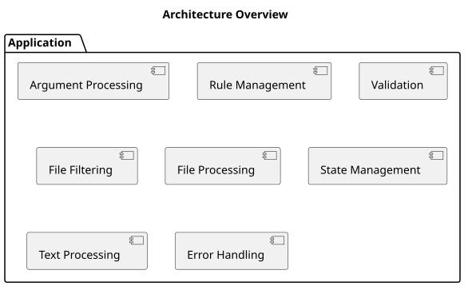

## Argument Processing

  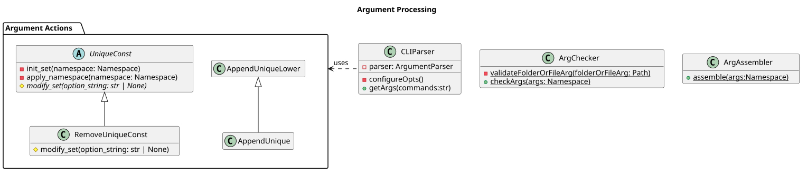

  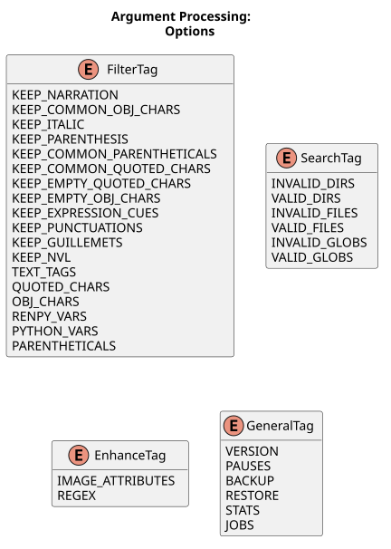

## File Filtering

  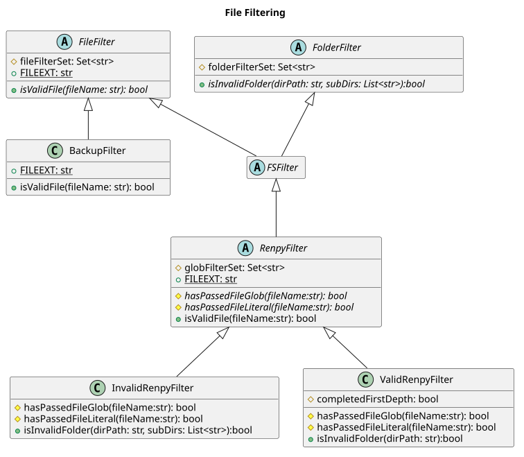

## File Processing

  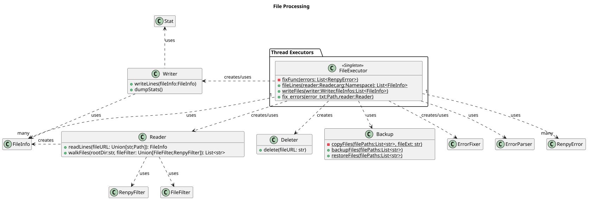

## Rule Management

  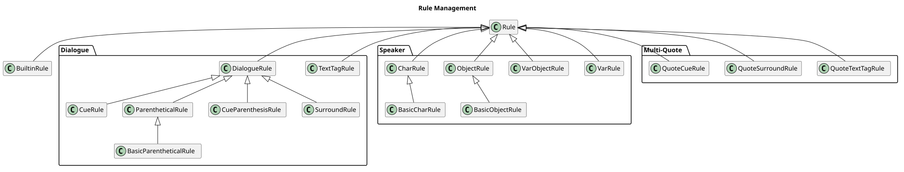

  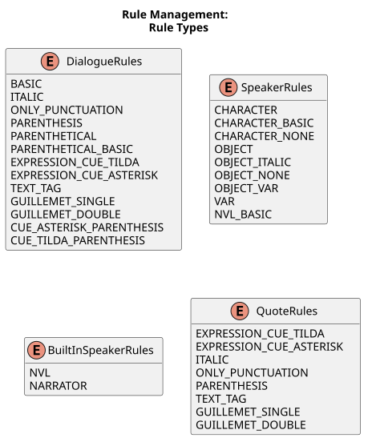

## Validation

  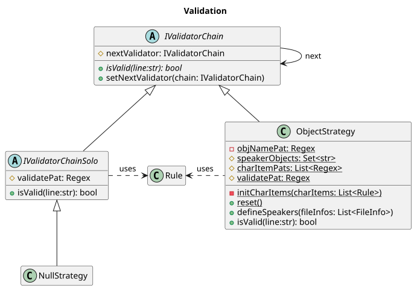

## Text Processing

  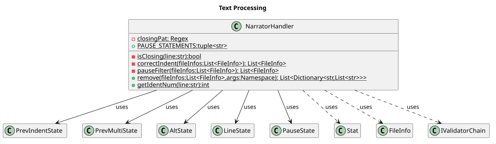

## State Management

  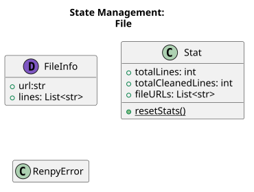

  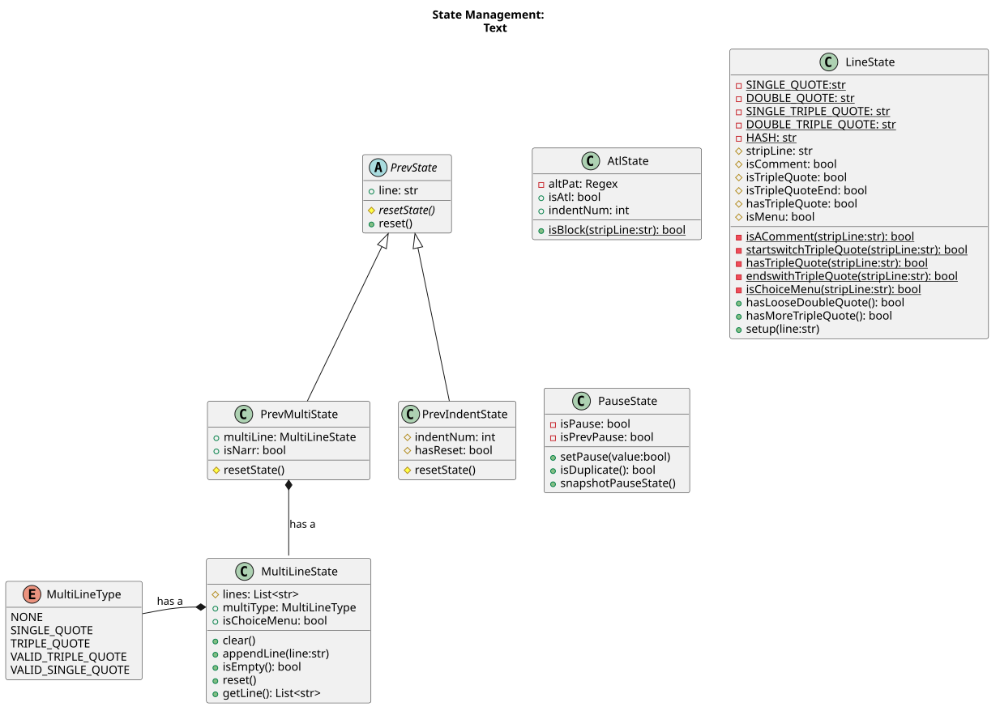

## Error Handling

  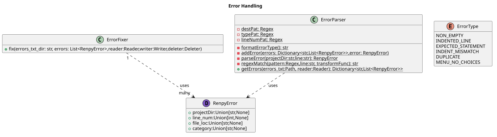

